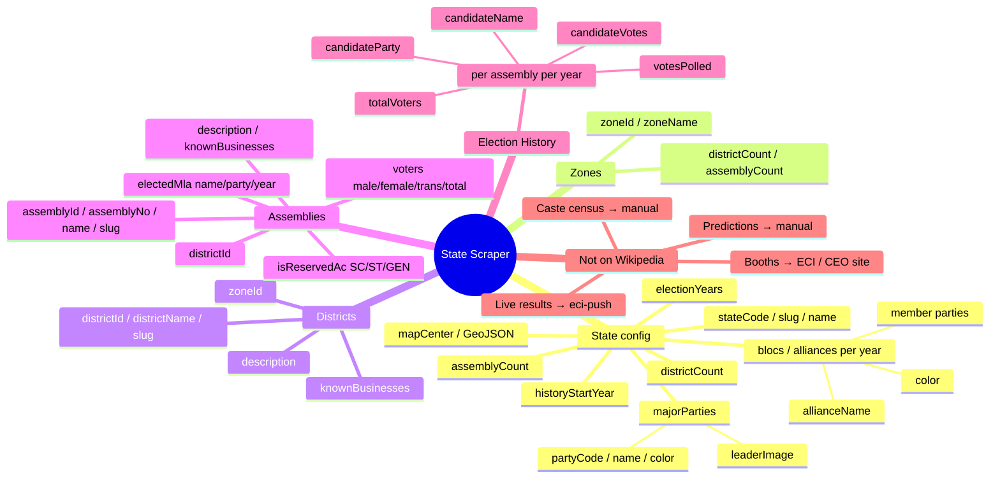

# Data Scraper — Wikipedia → State Data

Goal: one agent run per Indian state → JSON matching our Payload collections.

## Mindmap



## Data points → Wikipedia source

| Target collection | Fields | Wikipedia page |
|---|---|---|
| `States` | name, assemblyCount, districtCount | `{State}` infobox |
| `States` | electionYears, historyStartYear | `{State} Legislative Assembly` |
| `States` / `Alliances` | parties, alliances, colors | `{Year} {State} Legislative Assembly election` |
| `Districts` | districtName, zone/division | `List of districts of {State}` |
| `Districts` | description, knownBusinesses | `{District} district` (lead + Economy) |
| `Assemblies` | assemblyNo, name, district, reserved (SC/ST) | `List of constituencies of the {State} Legislative Assembly` |
| `Assemblies` | electedMla | same list (current member column) |
| `Assemblies` | description | `{Name} (Assembly constituency)` lead |
| `ElectionHistory` | candidate, party, votes, electors, polled | `{Name} (Assembly constituency)` → "Election results" tables |
| `Zones` | zoneName | divisions/regions in district list |

Gaps (not reliable on Wikipedia): booths, voter gender split, caste %, live results.

## Agent pipeline

```
fetch (MediaWiki API, action=parse) → parse tables → normalize → validate → output/{stateCode}/*.json → seed script
```

1. **fetch** — `https://en.wikipedia.org/w/api.php?action=parse&page=…&format=json`, cache raw HTML in `cache/`.
2. **parse** — wikitable → rows; infobox → key/value.
3. **normalize** — IDs (`ac001`, `dt1`), slugs, party codes via `partyNameMap`.
4. **validate** — counts match infobox; every assembly maps to a district; votes sum ≤ polled.
5. **output** — `output/{stateCode}/{states,zones,districts,assemblies,election-history,alliances}.json`.
6. **seed** — reuse pattern from `scripts/seed-up-data.mts`.

## Folder layout

```
data-scraper/
  README.md
  src/
    fetch.ts        # MediaWiki API + cache
    parsers/        # infobox, constituency list, results table
    normalize.ts
    validate.ts
    run.ts          # --state=KA
  cache/            # gitignored
  output/{stateCode}/
```
